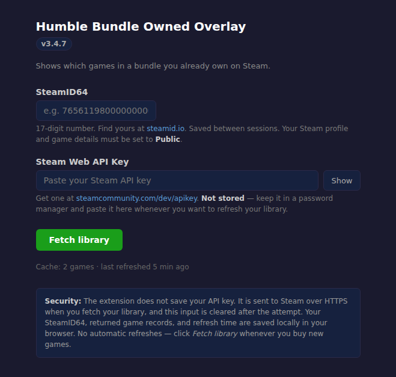
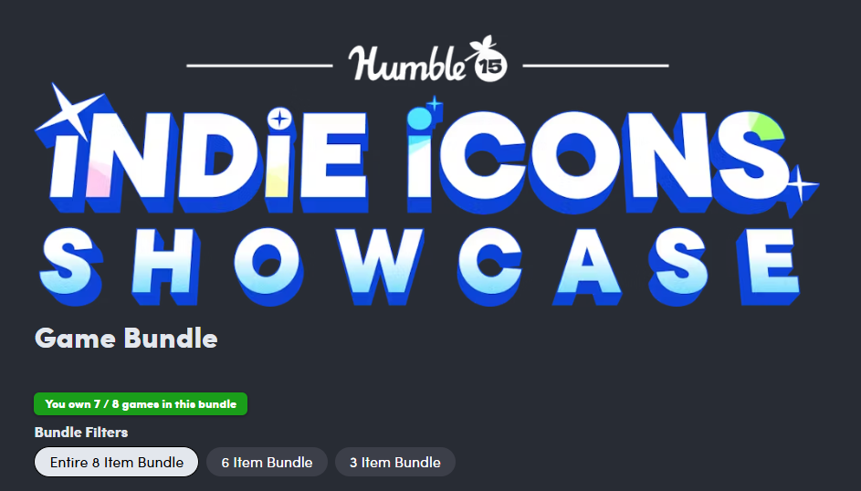
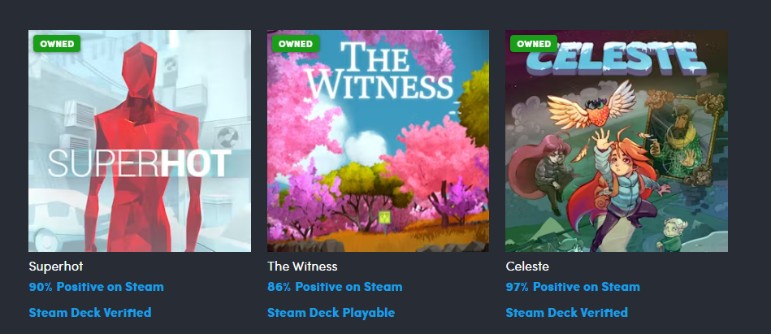

# Humble Bundle Owned Overlay

A personal browser extension that shows which games in a Humble Bundle you already own on Steam.

The published Chrome baseline is v3.3.9. The canary build preserves the existing toolbar cache-status popup. This canary checkout contains v3.4.6 development changes and a Firefox build awaiting final manual acceptance and Mozilla signing. Native Chromium and Firefox checks on public Humble pages have passed; see [BROWSER-VALIDATION.md](BROWSER-VALIDATION.md) for the tested scope and remaining checks.

> **Disclaimer:** This extension was built collaboratively with [Claude](https://claude.com) for personal use and learning. I am not a software engineer. The code is published as-is — review it yourself before installing.

- Green **OWNED** badge on each game tile you already have
- "X / Y games owned" counter near the bundle title
- Toolbar popup with library cache status and a settings shortcut


## Screenshots

**Options page**



**Bundle overlay**



**Owned game badges**



## How it works

You set up a Steam Web API key + SteamID64 once. On the extension's options page, paste those and click **Fetch library** — the extension fetches your owned games from Steam, stores **only the game list** locally, and immediately discards the API key. Next time you want to refresh (after buying new games), you paste the key again.

On supported Humble game bundle and Humble Choice pages, game titles are compared with your cached Steam library and matches are badged. Non-Steam Choice items, playtests, books, and software bundles are ignored. Title matching does not guarantee ownership of a particular edition, remaster, or its DLC. Non-Latin names that normalize to an empty value are skipped. Free games are excluded by the current Steam request's default settings. Ordinary bundle discovery does not verify each item's delivery platform.

## Setup

1. **Get a Steam Web API key** at https://steamcommunity.com/dev/apikey (domain can be `localhost`)
2. **Get your SteamID64** at https://steamid.io
3. **Make sure your Steam profile + Game details are set to Public** (Steam → Privacy → Game details = Public)

## Install

For the published Chrome version, use the [Chrome Web Store listing](https://chromewebstore.google.com/detail/humble-bundle-owned-overl/bkbliccgapgfedaploklillhkmlailik).

For a Chrome development checkout:

1. Download the ZIP from this repo (Code → Download ZIP) — or `git clone`
2. Extract to a stable folder
3. Chrome → `chrome://extensions` → enable **Developer mode** → **Load unpacked** → pick the folder
4. Right-click the extension → **Options** → paste your Steam API key + SteamID64 → click **Fetch library**

For Firefox development testing, first build the packages below. Open `about:debugging#/runtime/this-firefox`, choose **Load Temporary Add-on**, and select `dist/firefox/manifest.json`. Temporary extensions disappear when Firefox restarts. The Firefox build uses MV3 background scripts and requires desktop Firefox 140 or later. Android has a declared minimum of 142 for data consent, but Android support has not been verified.

A Firefox ZIP is unsigned and cannot be permanently installed into normal release Firefox until Mozilla signs it. There is no published Firefox listing yet. Use a separate test profile to compare development builds against the working Chrome version.

## Development and packaging

Use Node.js 22.22.2 or later in the 22.x series, or a newer compatible LTS version. Runtime files have no third-party dependencies. `jsdom` and Mozilla `web-ext` are pinned development tools for DOM regression tests and Firefox validation.

```sh
npm ci --ignore-scripts
npm test
npm run validate
npm run build:zip
npm run lint:firefox
```

`build:zip` produces unpacked directories at `dist/chrome` and `dist/firefox`, plus a separately named ZIP for each browser. `npm run build:chrome` and `npm run build:firefox` rebuild one browser without deleting the other. Only the generated manifests differ between browsers; all runtime JavaScript, HTML, and CSS is shared. The root manifest remains the Chrome source manifest.

To name a canary package, set `RELEASE_TAG=v3.4.6-canary.1` in your shell before building. GitHub tag builds validate that the tag agrees with the manifest version. A GitHub canary label does not create a distinct installable manifest version or a Mozilla-signed package.

See [TESTING.md](TESTING.md) for browser acceptance checks. See [FIREFOX.md](FIREFOX.md) for signing and submission requirements.

## Use

After the initial fetch, open any supported Humble game bundle or Humble Choice page — owned Steam games get a green badge.

Whenever you want to refresh (e.g. after buying new games), open the extension options, paste the key, click **Fetch library**.

Click the pinned toolbar icon to check how many games are cached and when the library was last refreshed.

Open Humble pages update from the new local cache after a successful fetch. A failed fetch keeps the previous library and saved account. Data remains local until you fetch again; browsing Humble does not trigger Steam API calls.

## Security

- **The extension does not persist the API key.** It is sent to Steam over HTTPS for a manual fetch, and the input is cleared after the attempt. Keep the key in a password manager and paste it whenever you want to refresh.
- **SteamID64 is stored** between sessions and identifies the account associated with a successful fetch.
- Returned Steam game records and their refresh time are cached in browser-local storage. These records can include app IDs, names, image references, and playtime fields returned by Steam.
- Host permissions: only `humblebundle.com` and `api.steampowered.com`.
- No analytics or remote code. The manual Steam API request sends your API key and SteamID64 to Steam; Humble page content is compared locally and is not transmitted.

If you ever want to rotate the key, click **Revoke** at https://steamcommunity.com/dev/apikey and generate a new one.

## Files

```
manifest.json       # MV3 manifest, minimal permissions
background.js       # service worker — Steam API fetch + cache
content.js          # runs on humblebundle.com — DOM scan + badging
content.css         # badge + counter styling
popup.html/.js      # toolbar cache-status popup
options.html/.js    # settings page
lib/normalize.js    # title-normalization helper (edition suffixes, etc.)
```

## Changelog

See [CHANGELOG.md](CHANGELOG.md) for version history.

## License

See [LICENSE](LICENSE).
