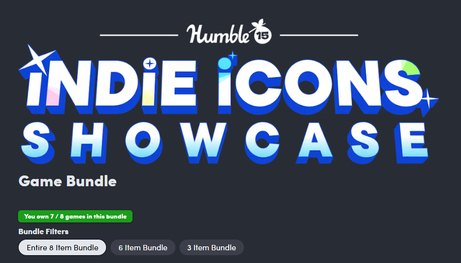
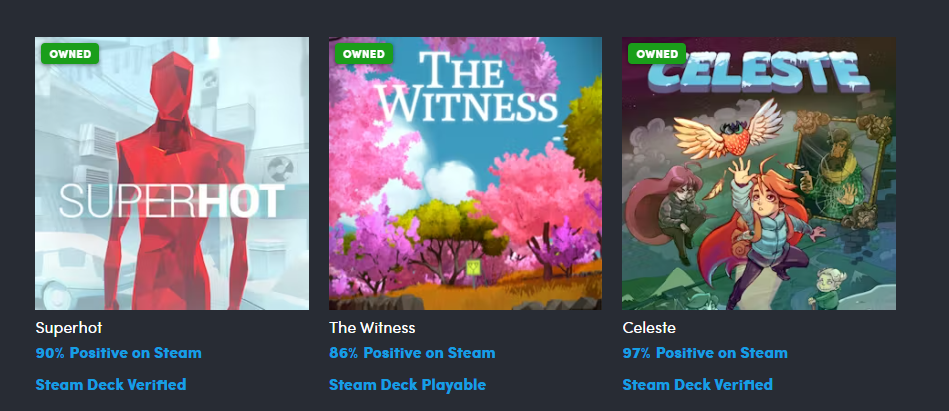

# Humble Bundle Owned Overlay

A browser extension that shows which games in a Humble Bundle or Humble Choice month you already own on Steam. Owned games get a green **Owned** badge, and a counter near the top shows "X / Y games owned".

Install it from the [Chrome Web Store](https://chromewebstore.google.com/detail/humble-bundle-owned-overl/bkbliccgapgfedaploklillhkmlailik). Problems or requests: [open an issue](https://github.com/Armadyl00/humble-owned-overlay/issues).

> **Status, November 2026:** Humble has redesigned its site. The store version (v3.4.7) only works on the old layout. v3.5.0 on the `canary` branch supports the new one, but I'm holding off on releasing it in case Humble rolls the redesign back.

> **Disclaimer:** This extension was built collaboratively with [Claude](https://claude.com) for personal use and learning. I am not a software engineer. The code is published as-is, so review it yourself before installing.

## Screenshots

These show Humble's old layout and will be redone once the redesign settles.





## Setup

1. Get a Steam Web API key at https://steamcommunity.com/dev/apikey (the domain can be `localhost`).
2. Find your SteamID64 at https://steamid.io.
3. Set your Steam profile and game details to Public (Steam → Privacy → Game details).
4. Open the extension's options, paste both in and click **Fetch library**.

Then open a Humble game bundle or Choice page. Anything you own gets badged.

The library doesn't update on its own. After buying games, open the options, paste the key again and fetch. Pages you already have open pick up the new list straight away. If a fetch fails, the previous list is kept. The toolbar popup shows how many games are cached and when they were last fetched.

## What it does and doesn't match

Games are matched by title against your cached Steam library, so a match doesn't guarantee you own that exact edition, remaster or its DLC.

- Book and software bundles, playtests and non-Steam Choice items are ignored.
- Free games aren't in the list Steam returns, so they never show as owned.
- Names that are entirely non-Latin characters are skipped.
- On ordinary bundle pages the extension doesn't check which platform each item is delivered on.

## Privacy

- The API key is never saved. It's sent to Steam over HTTPS for the fetch and the box is cleared afterwards. Keep it in a password manager. If you want to rotate it, revoke it at https://steamcommunity.com/dev/apikey and generate a new one.
- Stored in the browser's local storage: your SteamID64, the game records Steam returned (app IDs, names, image references and playtime fields) and the time of the last fetch.
- The only network request the extension makes is that manual fetch from Steam. Humble pages are compared locally and nothing about them is sent anywhere.
- No analytics and no remote code. Host permissions are `humblebundle.com` and `api.steampowered.com` only.

See [PRIVACY.md](PRIVACY.md) for the full policy.

## Installing from source

Browser packages are on [GitHub Releases](https://github.com/Armadyl00/humble-owned-overlay/releases/latest).

Chrome: extract the Chrome ZIP (or clone this repo) to a folder that won't move, open `chrome://extensions`, turn on **Developer mode**, click **Load unpacked** and pick the folder.

Firefox: extract the Firefox ZIP, open `about:debugging#/runtime/this-firefox`, choose **Load Temporary Add-on** and select `manifest.json` (`dist/firefox/manifest.json` for a source build). Temporary add-ons disappear when Firefox restarts. The Firefox build needs desktop Firefox 140 or later and is unsigned, so it can't be permanently installed in release Firefox until Mozilla signs it. Android hasn't been tested.

## Development and packaging

Use Node.js 22.22.2 or later in the 22.x series, or a newer compatible LTS version. Runtime files have no third-party dependencies. `jsdom` and Mozilla `web-ext` are pinned development tools for DOM regression tests and Firefox validation.

```sh
npm ci --ignore-scripts
npm test
npm run validate
npm run build:zip
npm run lint:firefox
```

`build:zip` produces unpacked directories at `dist/chrome` and `dist/firefox`, plus a separately named ZIP for each browser. `npm run build:chrome` and `npm run build:firefox` rebuild one browser without deleting the other. Only the generated manifests differ between browsers; all runtime JavaScript, HTML, and CSS is shared. The root manifest remains the Chrome source manifest.

To name a canary package, set `RELEASE_TAG=v3.4.7-canary.1` in your shell before building. GitHub tag builds validate that the tag agrees with the manifest version. A GitHub canary label does not create a distinct installable manifest version or a Mozilla-signed package.

Successful CI on `main` publishes the current version's Chrome and Firefox ZIPs as a GitHub release. Existing releases are left unchanged. Browser-store submission is separate.

Icon PNGs are checked in. To regenerate them after editing `icons/icon.svg`, run `bash scripts/render-icons.sh` with librsvg's `rsvg-convert` installed. Normal builds do not require this tool.

See [TESTING.md](TESTING.md) for browser acceptance checks. See [FIREFOX.md](FIREFOX.md) for signing and submission requirements.

## Files

```
manifest.json       # MV3 manifest
background.js       # service worker: Steam API fetch and cache
content.js          # runs on humblebundle.com: finds games and adds badges
content-choice-badges.js  # badges on the redesigned Humble Choice pages
content.css         # badge and counter styling
icons/              # vector source and PNG extension icons
popup.html/.js      # toolbar popup with cache status
options.html/.js    # settings page
lib/normalize.js    # title normalisation (edition suffixes etc.)
```

Version history is in [CHANGELOG.md](CHANGELOG.md). Tested scope is in [BROWSER-VALIDATION.md](BROWSER-VALIDATION.md).

## License

See [LICENSE](LICENSE).
